# Lab 02 - Amazon S3 | Static Website

> The Sky Is Not the Limit.
>
> Da teoria à prática, construindo meu futuro na nuvem.


## Sobre o projeto

Laboratório prático realizado em 24/11/2026 durante
o programa AWS re/Start da Escola da Nuvem.

O objetivo foi aplicar os conhecimentos sobre
armazenamento de objetos e publicação de conteúdo
estático utilizando Amazon S3.

A atividade foi ampliada para uma página educacional
interativa chamada Minha Jornada Cloud.

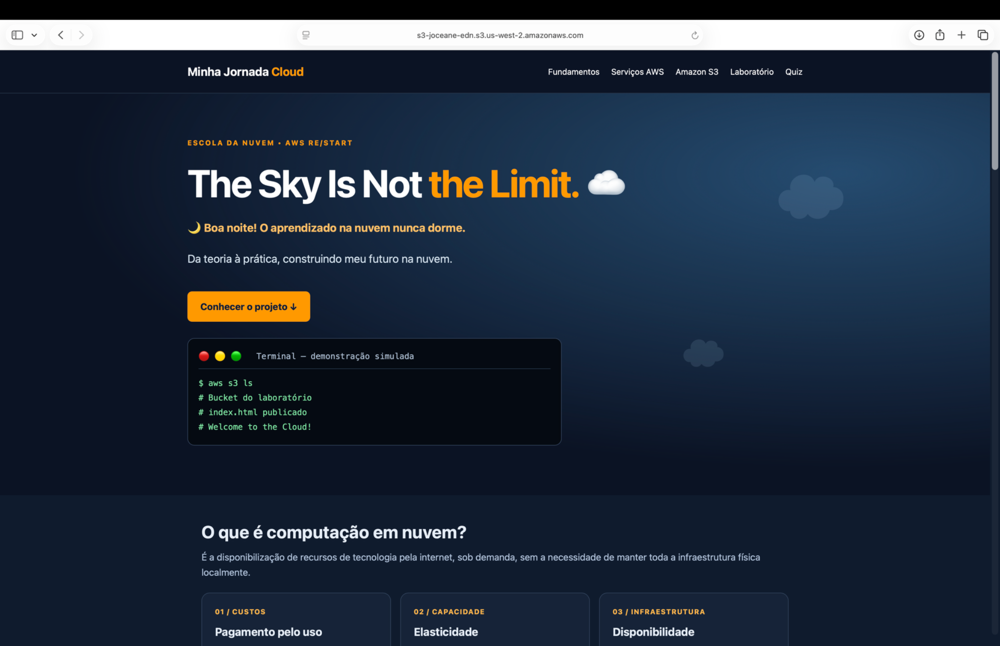

## Objetivos

- Compreender o funcionamento do Amazon S3.
- Criar e configurar um bucket.
- Realizar upload de objetos.
- Configurar permissões de leitura.
- Publicar conteúdo estático na AWS.
- Validar o acesso pelo navegador.
- Preservar o código e as evidências do laboratório.
- Documentar a experiência utilizando Git e GitHub.

## Tecnologias utilizadas

- Amazon Web Services (AWS)
- Amazon S3
- HTML5
- CSS3
- JavaScript
- Git e GitHub
- Terminal macOS
- curl
- GitHub Pages (demonstração permanente publicada)

## Arquitetura implementada

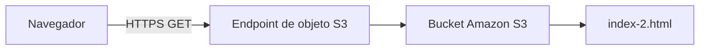

O navegador realiza uma requisição HTTPS ao endpoint
regional do objeto armazenado no Amazon S3.

O HTML, CSS e JavaScript são interpretados localmente
pelo navegador, sem necessidade de servidor de aplicação
ou banco de dados.

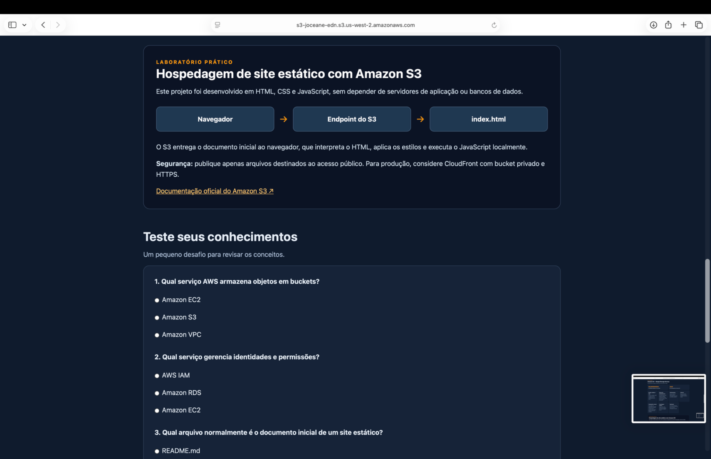

## Configurações do laboratório

| Configuração | Valor |
|---|---|
| Serviço | Amazon S3 |
| Bucket | s3-joceane-edn |
| Região | us-west-2 - Oregon |
| Tipo de bucket | Uso geral |
| Objeto publicado | index-2.html |
| Tamanho | 16,3 KB |
| Classe de armazenamento | S3 Standard |
| Versionamento | Desabilitado |
| Controle de acesso do objeto | ACL |
| Permissão pública do objeto | Leitura |
| Protocolo | HTTPS |
| Ambiente | Laboratório educacional temporário |

### Endpoint utilizado

O acesso original ocorreu pela URL direta do objeto:

https://s3-joceane-edn.s3.us-west-2.amazonaws.com/index-2.html

Este endereço é mantido apenas como registro histórico.

A publicação utilizou o endpoint regional de objetos
do S3. Não foi confirmada a habilitação do recurso
Static Website Hosting do bucket.

## Etapas realizadas

### 1. Criação do bucket

Criação de um bucket de uso geral na região
us-west-2 (Oregon).

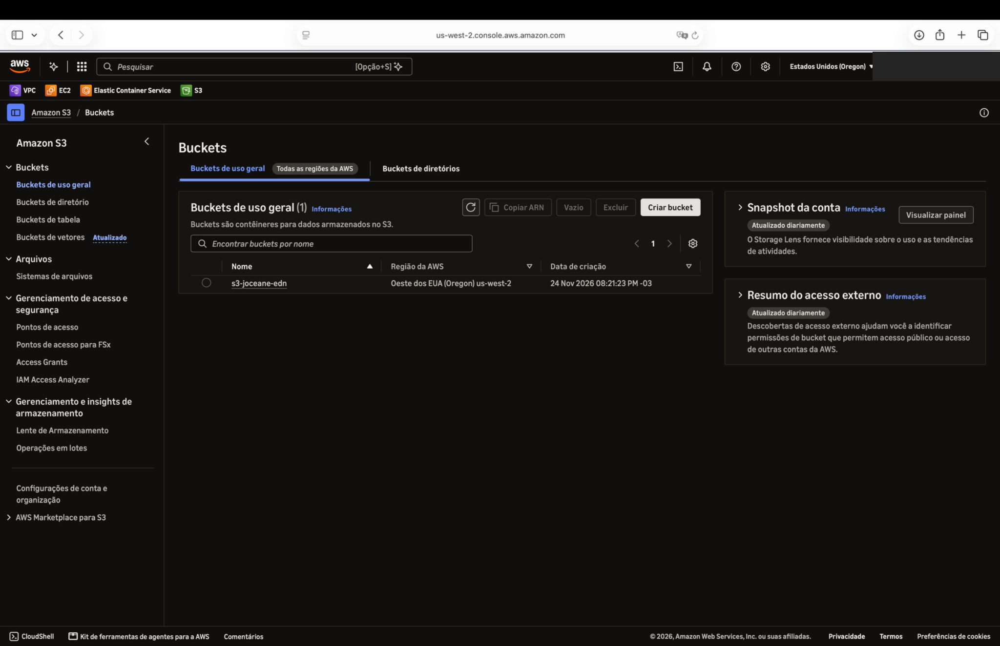

### 2. Upload do objeto

Publicação do arquivo HTML no bucket.

Todo o CSS e JavaScript foi incorporado ao próprio
documento HTML.

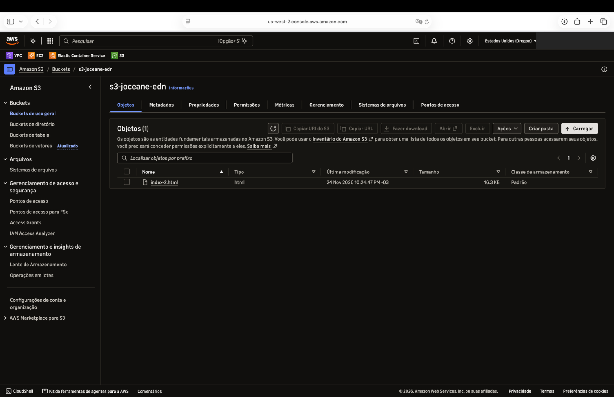

### 3. Verificação das propriedades

Validação do tamanho, região, classe de armazenamento
e informações do objeto publicado.

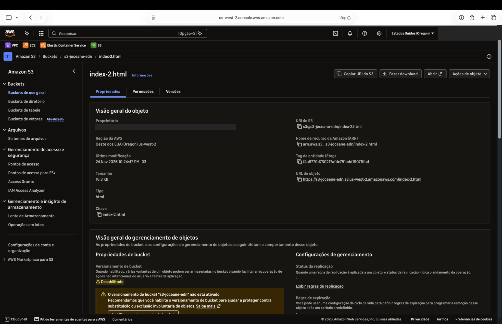

### 4. Configuração de permissões

Foi utilizada uma ACL para permitir a leitura pública
do objeto HTML durante o laboratório.

Essa configuração foi utilizada exclusivamente para
a atividade educacional.

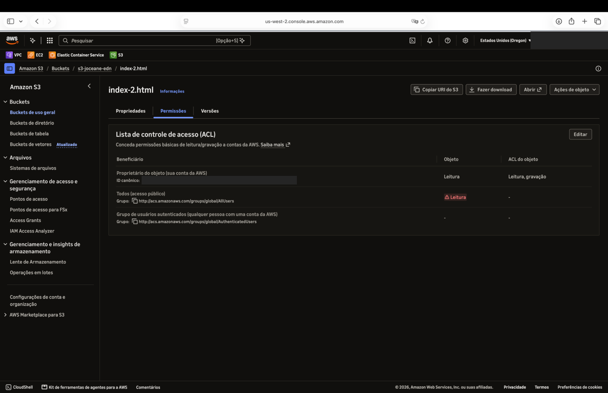

### 5. Validação do acesso

O conteúdo foi acessado com sucesso pelo navegador
utilizando o endpoint HTTPS do objeto.


## Funcionalidades da aplicação

- Layout responsivo.
- Tema visual inspirado nas cores da AWS.
- Saudação automática conforme o horário local.
- Animações de nuvens.
- Terminal AWS CLI simulado.
- Cards interativos dos serviços AWS.
- Conteúdo educacional sobre Amazon S3.
- Diagrama da arquitetura.
- Quiz interativo com sete perguntas.
- Correção automática e pontuação.
- Links para documentação oficial.

### Fundamentos de computação em nuvem

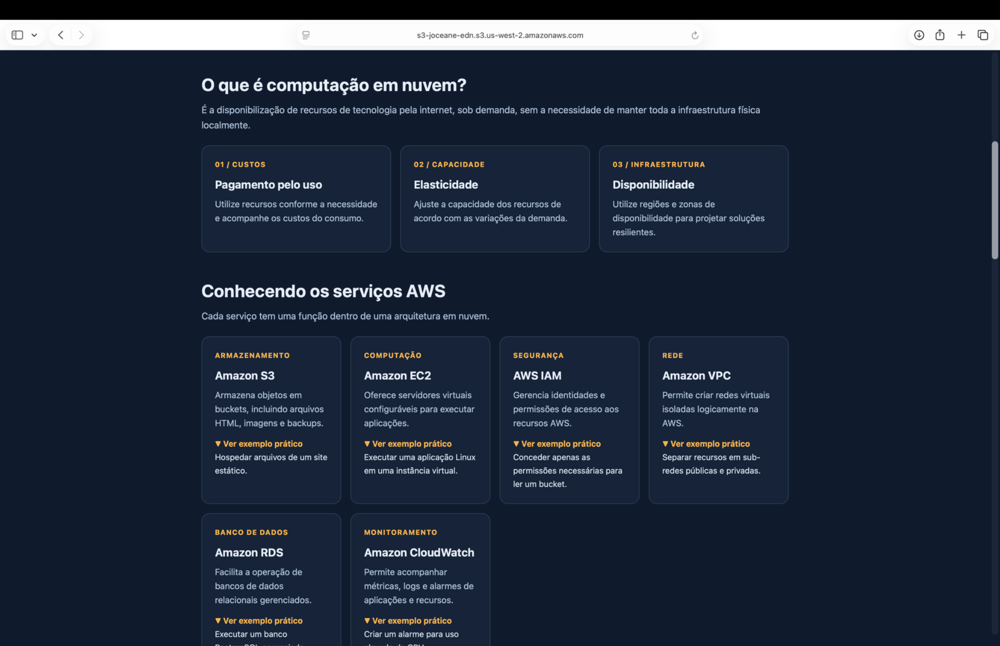

### Serviços AWS

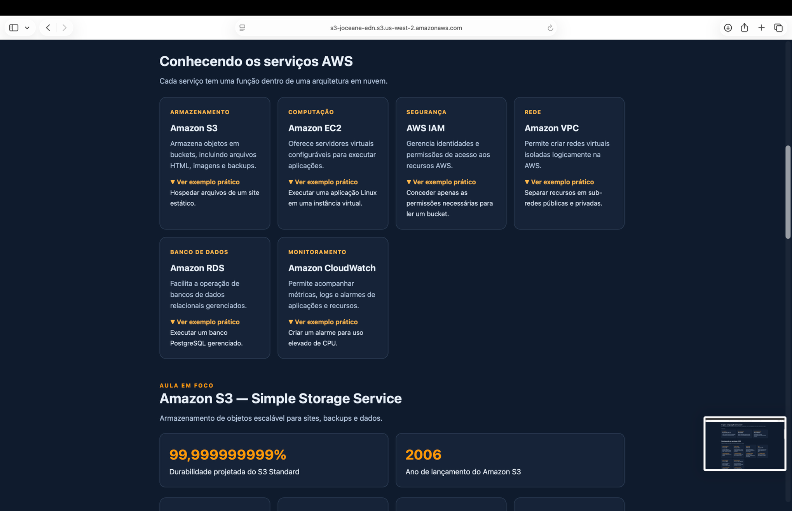

### Conceitos do Amazon S3

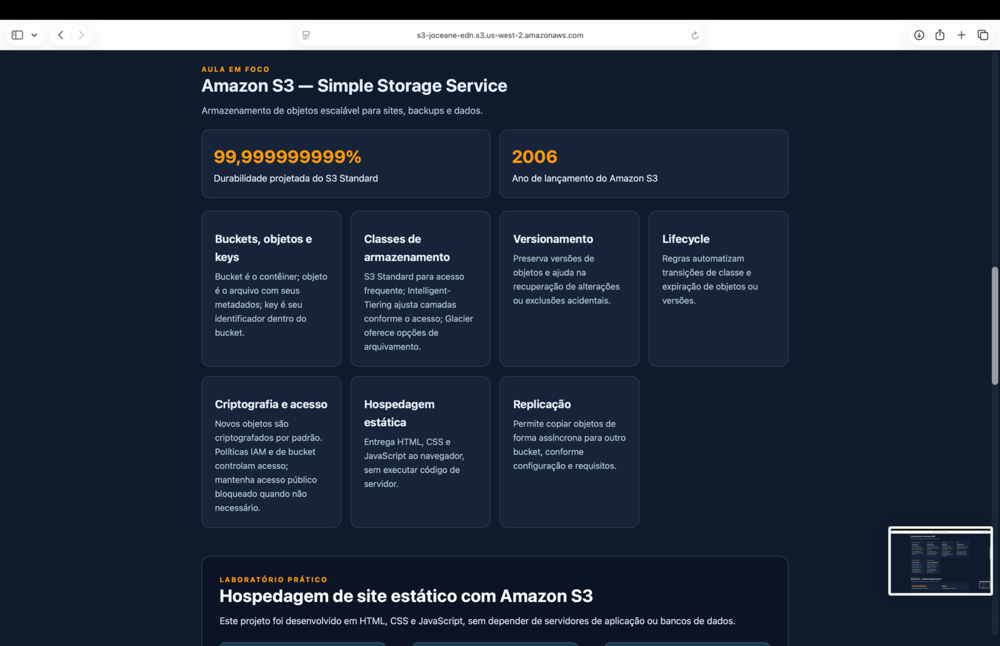

### Quiz interativo

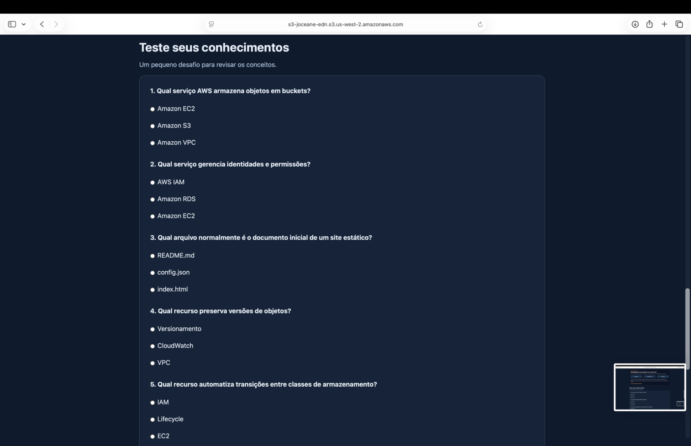

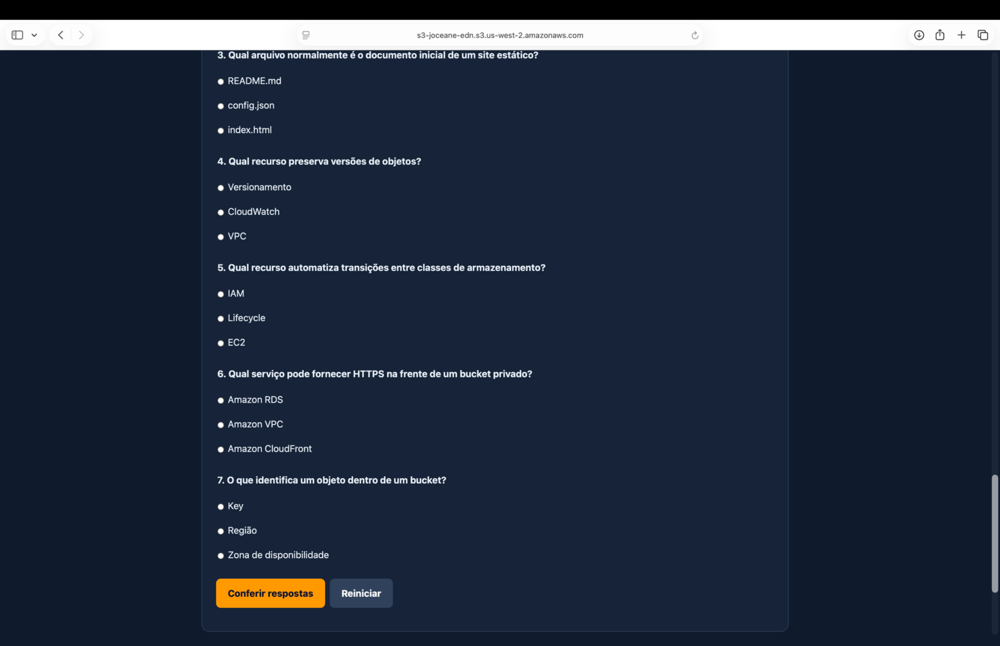

### Identidade visual

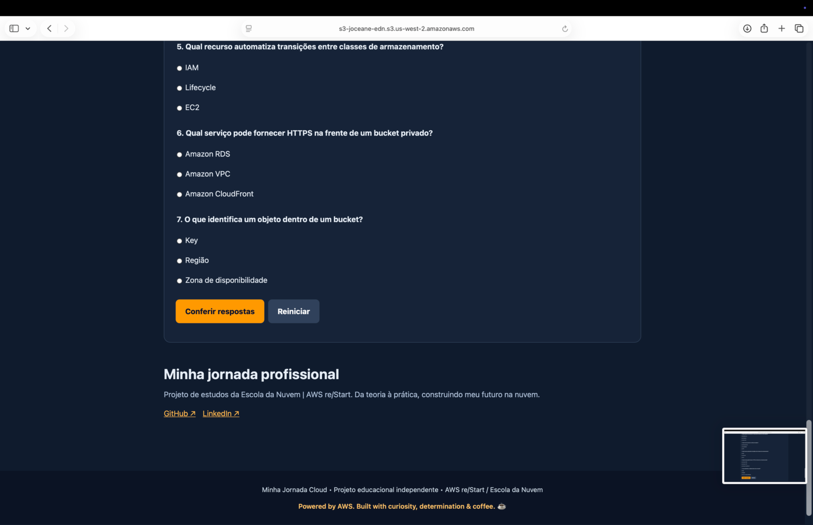

## Backup e validação de integridade

Como o ambiente AWS do laboratório era temporário,
foi realizado o download do objeto publicado antes
do encerramento da sessão.

A cópia baixada diretamente do Amazon S3 foi comparada
com o arquivo local utilizando o comando cmp.

```bash
cmp "$HOME/Downloads/backup-lab-02-s3.html" \
lab-02-s3-static-website/index.html
```

Resultado: arquivos idênticos.

Também foram preservados screenshots e gravações
de tela para documentação e demonstração do projeto.

## Problemas encontrados

Durante a tentativa de consultar as configurações
do bucket pela AWS CLI, a sessão de autenticação
estava expirada.

```text
Your session has expired.
Please reauthenticate using 'aws login'.
```

As configurações documentadas foram recuperadas
por meio das evidências capturadas no console AWS.

Também foi identificada uma restrição de privacidade
do macOS ao listar arquivos da Mesa pelo terminal.

A organização das evidências foi realizada utilizando
o Finder e comandos locais.

## Segurança e boas práticas

- Não versionar credenciais ou chaves privadas.
- Utilizar o princípio do menor privilégio.
- Publicar somente arquivos destinados ao acesso público.
- Evitar exposição desnecessária de identificadores AWS.
- Manter backups dos artefatos importantes.
- Validar a integridade dos arquivos.
- Manter ambientes educacionais separados da produção.
- Encerrar recursos temporários para evitar custos.

### Recomendações para produção

Em um ambiente de produção, uma arquitetura mais
adequada pode utilizar Amazon CloudFront com
Origin Access Control (OAC), bucket privado e HTTPS.

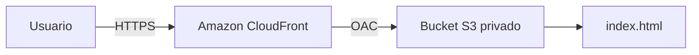

Essa arquitetura é uma proposta de evolução,
não uma configuração implementada neste laboratório.

## Executar localmente

Clone o repositório:

```bash
git clone https://github.com/joceschneider/lab-02-s3-static-website.git
cd lab-02-s3-static-website
```

No macOS:

```bash
open index.html
```

Não é necessário instalar bibliotecas adicionais.

## Demonstração permanente

O projeto está publicado no GitHub Pages, permitindo
o acesso público ao site independentemente do
ambiente temporário da AWS.

- [Acessar site funcional](https://joceschneider.github.io/lab-02-s3-static-website/)
- [Repositório público](https://github.com/joceschneider/lab-02-s3-static-website)

Status: publicação concluída e acesso validado.

O ambiente original foi hospedado no Amazon S3.
A demonstração permanente utiliza GitHub Pages.

## Encerramento do ambiente

O laboratório foi executado em ambiente educacional
temporário, sujeito à destruição automática pela
plataforma.

- [x] Publicação do objeto na AWS
- [x] Validação do acesso pelo navegador
- [x] Backup do código-fonte
- [x] Validação de integridade
- [x] Registro das evidências
- [x] Preservação das gravações
- [ ] Confirmação do encerramento do ambiente AWS
- [x] Publicação permanente no GitHub Pages

## Conhecimentos adquiridos

- Armazenamento de objetos.
- Buckets e object keys.
- Classes de armazenamento.
- Controle de acesso.
- Publicação de conteúdo estático.
- Conceitos de segurança em cloud.
- Backup e integridade de arquivos.
- Documentação técnica.
- Versionamento de código.

## Referências

- [Amazon S3](https://aws.amazon.com/pt/s3/)
- [Documentação do Amazon S3](https://docs.aws.amazon.com/pt_br/AmazonS3/latest/userguide/Welcome.html)
- [AWS re/Start](https://aws.amazon.com/pt/training/restart/)
- [Escola da Nuvem](https://escoladanuvem.org/)
- [GitHub Pages](https://docs.github.com/pt/pages)

## Autora

Joceane Schneider

Projeto educacional desenvolvido durante a jornada
de aprendizado em Cloud Computing.

[GitHub](https://github.com/joceschneider)

---

*Powered by AWS. Built with curiosity, determination & coffee.*
